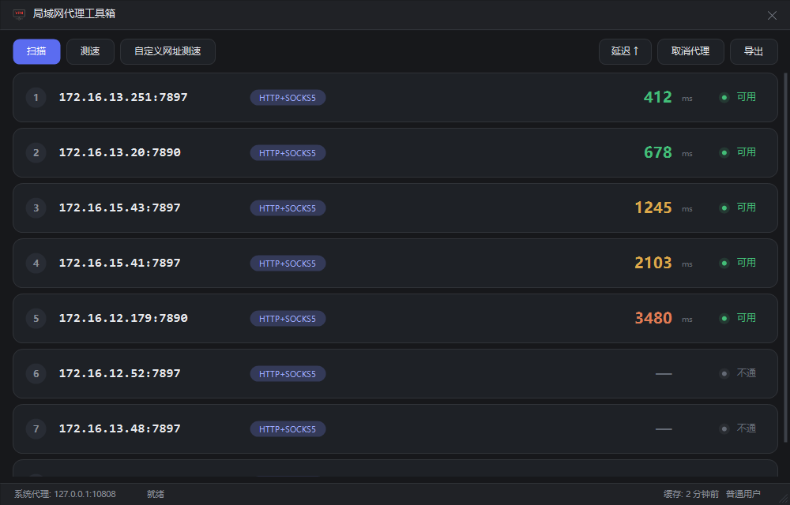

# ProxyTool · 局域网代理工具箱

一个用于**扫描局域网内可用 HTTP/SOCKS5 代理、测试连通性与延迟、一键切换 Windows 系统代理**的小工具。

纯 C# / WinForms 实现，单文件 exe，约 70 KB，**无需安装 .NET SDK、无需管理员权限即可运行**。



---

## 功能特性

- **自动识别网段** — 读取本机已启用、带默认网关、且为私网地址的网卡，按实际掩码计算 CIDR（超过 /21 会截断，避免扫几万台）
- **多端口并发扫描** — 覆盖 Clash / v2rayN / Squid / Privoxy 等常见代理端口，TCP 连接扫描，批次 64 台主机
- **协议自动识别** — 通过 HTTP `CONNECT` 与 SOCKS5 握手区分代理类型，排除普通 Web 服务
- **Google 延迟测试** — 8 并发测速，3 档配色（<1s 绿 / <3s 橙 / >3s 红），支持自定义网址；HTTPS 受限时自动回退到 HTTP 端点复测
- **一键切换系统代理** — 写入 `HKCU\...\Internet Settings`，浏览器即时生效；权限不足时可弹窗提权
- **卡片式界面** — 深色主题、自绘控件、双击行即设为代理、右键菜单、点表头排序
- **结果缓存** — 扫描与测速结果落盘，下次启动直接加载，无需重扫
- **随时可停** — 扫描/测速过程中点「停止」立即恢复界面，后台线程自行收尾

## 快速开始

1. 下载或构建 `ProxyTool.exe`
2. 双击运行
3. 点左上角 **扫描**，等待扫描完成（/24 约 1 分钟，/22 约 3 分钟）
4. 双击任意一条可用记录，或右键选择「设为系统代理」

恢复直连：点 **取消代理**。

> 关闭窗口 = 退出程序，不驻留后台。

## 构建

只需要 Windows 自带的 .NET Framework 4.x（Win10/11 默认具备），**不需要**装 .NET SDK 或 Visual Studio。

```powershell
powershell -ExecutionPolicy Bypass -File .\build.ps1
```

产物：根目录下的 `ProxyTool.exe`（约 67 KB）。

### build.ps1 参数

| 参数 | 作用 |
|---|---|
| 无 | 编译 `ProxyTool.exe` |
| `-Clean` | 删除 `ProxyTool.exe` |

> 直接双击 `build.ps1` 可能被「禁止运行脚本」的默认执行策略拦下，请用上面的 `-ExecutionPolicy Bypass` 方式调用。

### 关于图标

图标是可选的：根目录存在 `app.ico` 时会被嵌入 exe，不存在时构建一个无图标版本，**不会报错**。

想替换图标，直接用自己的 `.ico` 覆盖 `app.ico`（建议包含 16/32/48/256 多个尺寸）再重新构建即可。

## 使用说明

| 操作 | 说明 |
|---|---|
| 双击卡片 | 设为系统代理 |
| 右键卡片 | 设为代理 / 单独测速 / 复制地址 / 从列表移除 |
| 点「延迟 ↑↓」 | 切换排序方向 |
| 滚轮 | 滚动列表 |
| 拖动标题栏 | 移动窗口 |
| 拖动窗口边缘 | 调整大小 |

### 命令行参数

| 参数 | 说明 |
|---|---|
| `--apply <ip:port>` | 静默设置代理（提权子进程内部使用） |
| `--unset` | 静默取消代理 |
| `--shot <file.png>` | 离屏渲染界面截图（调试用） |
| `--bench` | 取消响应基准测试（调试用） |

## 工作原理

1. **网段发现**：`NetworkInterface.GetAllNetworkInterfaces()` 过滤 Loopback / Tunnel / 无网关 / 非私网地址
2. **端口扫描**：`Socket.BeginConnect` + 超时等待，`Parallel.ForEach` 控制并发（默认 384）
3. **协议识别**：
   - HTTP 代理：发送 `CONNECT www.google.com:443`，看是否返回 `200`
   - SOCKS5：发送版本协商 `05 01 00`，再发 CONNECT 请求，看返回码
4. **延迟测试**：`HttpWebRequest` + `WebProxy`，8 并发，超时 8 秒
5. **系统代理**：写注册表 `ProxyEnable` / `ProxyServer`，调用 `InternetSetOption` 通知 WinINET 刷新

## 常见问题

**Q：为什么只扫私网地址？**
避免误扫公网。支持 `10.0.0.0/8`、`172.16.0.0/12`、`192.168.0.0/16`、`100.64.0.0/10`。

**Q：提示需要管理员权限？**
部分机器上 `Internet Settings` 键被组策略或安全软件收紧了 ACL，普通用户写入会被拒。程序会在失败时弹窗询问是否提权（UAC），仅此一步需要管理员。

**Q：扫描很慢 / 扫不到东西？**
- 目标机器上的代理软件必须开启「允许局域网连接」，否则端口不对外监听
- 酒店、机场等公共 WiFi 通常开启了 AP 隔离，设备之间不通，扫不到是正常现象
- 公司网络可能限制扫描行为，请遵守所在网络的使用规范

**Q：被安全软件拦截？**
程序会进行局域网端口扫描，可能触发 EDR/SmartScreen 告警。exe 未做代码签名，如果从网络下载可能提示「未知发布者」，选择「仍要运行」即可。

**Q：测速时点停止，为什么后台还在跑？**
点击停止后界面立即恢复（实测 <5ms），但已经建立的 TCP 连接无法被 `HttpWebRequest.Abort()` 立刻中断，后台线程会自己等到超时（最长约 20 秒）后退出。这期间不影响任何操作，结果也会被丢弃。

## 目录结构

```
.
├── src/
│   └── ProxyTool.cs      # 主程序（界面 + 扫描 + 测速 + 注册表）
├── docs/
│   └── screenshot.png
├── app.ico               # 可选：程序图标
├── build.ps1             # 构建脚本
├── README.md
```

## 免责声明

本工具仅用于**自有网络或已获授权**的环境下的网络诊断与配置。
请勿用于未经授权的网络探测；使用他人设备上的代理前，应取得对方同意。


## 友链

[linux.do](https://linux.do/)
